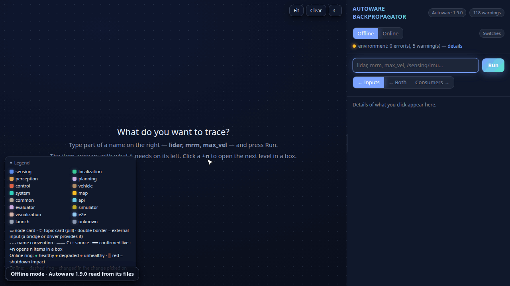

# Autoware Backpropagator (`adviewer`)

[](https://github.com/shrikantwaghule2106/Autoware_Backpropagator/actions/workflows/ci.yml)

I built this local web app to see the **Autoware Universe** architecture in one place. It reads
Autoware's launch files, parameters, message definitions and diagnostics graph into one graph,
lets me drill from any topic to what feeds it and what it feeds, and, with a live probe, shows
what a running Autoware actually does. It is for anyone who has to **analyse, plan and map**
Autoware's interfaces onto a simulator (e.g. CARLA) or real hardware.

## Compatibility

| | Works with | Tested on |
|---|---|---|
| Autoware | **1.9.0** (its release data is included); other releases load, with warnings | 1.9.0 |
| Python | 3.10 – 3.13 | 3.12 (CI runs 3.10, 3.12 and 3.13) |
| Offline mode | Linux; Windows and macOS should work (pure Python) | Ubuntu 24.04 |
| Online mode | Linux, Docker Engine | Ubuntu 24.04, Docker 29 |
| ROS 2 (Online) | Jazzy (default), Humble; CI also builds the probe on Kilted, Lyrical and Rolling | Jazzy with Autoware 1.9.0; Humble with a test publisher |
| DDS (Online) | CycloneDDS, Fast DDS | both |

**Not tested yet:** real Windows and macOS machines · a Humble, Kilted or Rolling Autoware ·
`--native` on a real host-built Autoware (only a stand-in) · Online mode on Docker Desktop (not
supported: no host network) · Zenoh · the "lidar + 3 cameras" load comparison on a full Autoware.
The installer is tested on Ubuntu 22.04 and 24.04, Debian 12 and Fedora 41 (fresh containers).



*Offline mode on Autoware 1.9.0: I search `concatenated`, pick the lidar point cloud, and a
`+n` opens the next level in a box. Online mode, on a dummy scenario (synthetic data, not a
recorded Autoware run): the Live dashboard shows every sensor and layer on one time axis. The
camera pipeline starts, the lidar rate drops, and the answer names the lidar point cloud as the
root: nothing connects it to the camera nodes, but CPU and GPU load rose.*

I called it *Backpropagator* because it **propagates backwards through the architecture**: I
pick the behaviour I care about (an MRM trigger, a control command) and the tool walks the graph
in reverse to show every topic, node and diagnostic that must be satisfied for it to work. It
has nothing to do with neural-network training.

## Quick start: Offline mode (about 5 minutes)

**1. Install** (once):

```bash
git clone https://github.com/shrikantwaghule2106/Autoware_Backpropagator.git
cd Autoware_Backpropagator
./install.sh
```

You should see `Ready. Next:`. Every problem it finds is printed with the command that fixes it.
Windows: `powershell -ExecutionPolicy Bypass -File install.ps1`.

**2. Make a project folder** (anywhere; it holds `adviewer.yaml` and the graph):

```bash
source /path/to/Autoware_Backpropagator/.venv/bin/activate    # Windows: .venv\Scripts\Activate.ps1
mkdir ~/aw-project && cd ~/aw-project
```

**3. Get Autoware's files.** Pick one row:

| You have | Run | Downloads |
|---|---|---|
| No Docker, or little disk space (simplest) | `adviewer init --from-source`<br>`adviewer fetch-source` | ~660 MB (git) |
| Docker and ~20 GB free | `adviewer init`<br>`adviewer extract`<br>`adviewer fetch-source` | 5 GB image + ~660 MB |
| Your own Autoware image | `adviewer init`<br>`adviewer extract --image <your-image>`<br>`adviewer fetch-source` | — |
| Autoware already on disk | `adviewer init --install-space <install-dir> --source <src-dir>` | — |

For Autoware 1.9.0 the first two rows give the same graph (the same nodes, topics, connections
and parameters). You should see `source ready in …` and, after `extract`, `install space ready
in … (N files)`. `extract` checks Docker and the free disk space before it downloads anything.

**4. Open it:**

```bash
adviewer up
```

You should see `adviewer: read 155 nodes, 284 topics, …` (Autoware 1.9.0) and
`adviewer: http://127.0.0.1:8765/`. Open that address in a browser, or in VS Code:
*Ctrl+Shift+P → Simple Browser: Show*. `adviewer init` also wrote VS Code tasks
(*Terminal → Run Task → adviewer: up*). Try it: search `concatenated`, pick the point cloud,
click `+n` to open the next level.

## Online mode: a running Autoware (Linux)

**1. Install the probe** (once): `./install.sh --online` in the `Autoware_Backpropagator` folder.
It builds the C++ probe image and checks Docker, the DDS settings and the kernel buffers.

**2. Run the probe** in your project folder. Pick your setup:

| Your setup | Run |
|---|---|
| Autoware in Docker: one container or a compose stack (with a simulator, a bridge, …), its own network or DDS file | `adviewer probe run --like <autoware-container>` |
| Autoware built on this machine (ROS 2 installed here) | `adviewer probe build --native` once, then `adviewer probe run --native` |
| Autoware on this machine's host network with default DDS settings | `adviewer probe run` |
| Message types that only another container has (e.g. a bridge) | a second probe: `--like <that-container> --out .adviewer/bridge_dump.json` |

You should see `wrote …probe_dump.json: N topics` every 5 seconds. `--like` uses that
container's image (all its message types), network, IPC and ROS/DDS settings; it builds a probe
for another ROS 2 distribution by itself, and when the container restarts it waits and joins it
again. Measure fewer topics with `--include '^/sensing/'` (each measured topic is delivered to
the probe: about a fifth of a CPU core per 20 MB/s).

**3. Open the live view:** `adviewer up --online`. The **Online** switch rings every topic green,
amber or red. The **Dashboard** puts every sensor and layer on one time axis with CPU, GPU and
memory: start parts of Autoware one by one and, for each change, it names the topic that dropped
first, the topics that followed and how they are connected to what just started. It reports what
changed together and how things connect; it does not prove the cause.
`adviewer compare lidar_only.json lidar_and_cameras.json` lists the rates that dropped under load.

## What it does

- **Architecture view:** nodes ↔ topics ↔ message types, grouped by layer (sensing, localization,
  perception, planning, control, vehicle, system, map), every connection with its file:line.
- **Drill-down:** a topic's inputs, consumers, message schema, the diagnostics that gate it, and
  what you must provide for it (MRM chains first).
- **Mapping assistant:** describe what your simulator or hardware provides (`target.yaml`, from
  `target.example.yaml`) and get a scored mapping onto Autoware's inputs and the single points of
  failure.
- **Where to edit:** every parameter with its file:line, value and how to override it.
- **Switches:** the launch arguments that turn parts of Autoware off, and what breaks then.
- **Environment check:** `adviewer doctor [--online]` prints each problem with its fix.

All commands: `adviewer --help` (and `adviewer <command> --help`).

## Troubleshooting

`adviewer doctor --online` checks everything Online mode needs and prints the fix for each problem.

**Install (`./install.sh`)**

| You see | Do this |
|---|---|
| `python3 not found` or `… is too old` | install Python 3.10+ (the line shows the command for your system), or `./install.sh --python /path/to/python3.12` |
| `could not create .venv` | clone into a folder you can write to |
| `this system has no CA certificates` | run the command it shows, then `./install.sh` again |
| `pip install failed` | check the internet connection; behind a proxy set `HTTPS_PROXY` |
| `no permission to use Docker` | `sudo usermod -aG docker $USER`, log out and in |
| `you are in the docker group, but this session started before` | log out and in, or `newgrp docker` |
| `the Docker daemon is not running` | `sudo systemctl start docker` |
| yellow `!` lines for `net.core.rmem_max`, `ipfrag`, `multicast on lo` | only matter for large data (point clouds, images) in Online mode; run the commands shown |

**Getting Autoware's files (`extract`, `fetch-source`)**

| You see | Do this |
|---|---|
| `probably not enough disk space for it` | free space, or use `adviewer init --from-source --force` (no image) |
| `adviewer extract needs Docker: …` | apply the fix shown, or use `--from-source` |
| `could not download <image>` | check the image name, the network, `docker login` for a private registry, the disk; or use `--from-source` |
| `no install space found in <image>` | `adviewer extract --image <image> --prefix <folder in the image that holds the packages>` |
| `git could not clone it` | network or proxy; run `adviewer fetch-source` again, it continues where it stopped |
| `… is at <tag>, not <tag>` | move that folder away and run `adviewer fetch-source` again |
| `git is not installed` | install git; on Windows, if a clone fails with "Filename too long": `git config --global core.longpaths true` |

**`adviewer up` and the page**

| You see | Do this |
|---|---|
| `no adviewer.yaml here or in a parent folder` | `cd` into your project folder, or run `adviewer init` |
| `install space not found` or `no Autoware nodes found` | the previous step did not finish: run `extract` or `fetch-source` again |
| the page shows an old graph | `adviewer up --reingest` (`up` reads again by itself when the saved graph is empty, after `adviewer.yaml` changes, or when `extract` / `fetch-source` add folders) |
| `port 8765 is busy (another adviewer?) → using 8766` | open the address it prints |
| many warnings (`direction unknown`, `not resolved`) | normal: what reading files alone cannot decide; list them with `adviewer warnings .adviewer/graph.json` |
| `release not recognised` | another Autoware release: it works, without the per-release data (layers, MRM rules) |

**Online mode (`probe run`)**

| You see | Do this |
|---|---|
| `the probe sees no topics` | is Autoware running? In Docker, use `--like <container>` (the message names the running ROS 2 containers); otherwise check `ROS_DOMAIN_ID` and `RMW_IMPLEMENTATION` |
| `not measured <topic> (<type>): package '…' not found` | that message type lives in another image: run a second probe `--like` that container |
| topics listed, but large ones (point clouds, images) at 0 Hz | raise the kernel buffers: the commands from `adviewer doctor --online` |
| `<container> stopped: waiting for it to run again` | nothing to do: the probe joins it again when it is back |
| `probe image … is older than this adviewer` | nothing to do: it is rebuilt once, by itself |
| `Docker Desktop (macOS/Windows) has no host network` | use `--like <container>`; Online mode is not supported on Docker Desktop |
| the Dashboard is empty | keep `probe run` or `up --online` running: a window is recorded every 5 seconds |
| the probe uses a lot of CPU | measure fewer topics: `--include '^/sensing/'` |

Still stuck? Open an issue with the output of `adviewer doctor --online` (leave out private topic
or container names).

## Contributing

Contributions are welcome: open an issue, or fork the repository and send a pull request to `main`.

```bash
./install.sh --dev && source .venv/bin/activate && pre-commit install
pre-commit run --all-files && pytest && mypy src      # what CI runs on every pull request
ADVIEWER_E2E=1 pytest tests/e2e                       # Online mode end to end (Docker, a few minutes)
```

- `src/adviewer/model/graph.py` is the data contract: change it on purpose.
- No ROS imports outside `src/adviewer/probe/`: the core runs on Windows and macOS.
- `src/adviewer/analysis/` is pure: a graph in, data out, no file or network access.
- Every graph edge carries a `confidence` and an `evidence` (file:line or a probe record).
- A parser feature comes with a fixture under `tests/fixtures/` and a test; a bug users can hit
  comes with a test that would have caught it (`tests/test_fault_corpus.py`, `tests/e2e/`).
- The UI (React + TypeScript in `ui/`): `ui/build.sh` type-checks, tests and builds into
  `src/adviewer/ui/static/`; commit that build (users need no Node.js).
- The probe (C++ in `src/adviewer/probe/cpp/`): a change to its image bumps `PROBE_VERSION` in
  `src/adviewer/probe_launch.py` and the `adviewer.probe` label in its Dockerfile.
- A new Autoware release: add `src/adviewer/data/autoware-<release>/`; the schemas in
  `src/adviewer/data/schema/` check it. Verify every fact in that release's source.
- Releases: set `__version__` in `src/adviewer/__init__.py`, then push a tag `v<version>`; the
  release workflow checks, builds and publishes it.

## Security

adviewer is local and read-only: the server listens on `127.0.0.1`, answers only GET requests, and
launch files are parsed, never executed. On a network address (`--host 0.0.0.0`) it requires the
token it prints; for remote use prefer an SSH tunnel (`ssh -L 8765:127.0.0.1:8765 <host>`). Report
security problems privately: *Security → Report a vulnerability* on this repository.

## Authorship and AI assistance

This is an **AI-assisted software project**. The project idea, scope, product decisions,
architecture direction and execution plan are my work and are owned by **me**. The
implementation code is produced with AI coding assistants (Anthropic Claude / Claude Code)
under my direction, review and debugging. I make no claim of hand-written coding
originality for the implementation; the contribution I claim is the concept, the system
design and the engineering judgement applied throughout.

## License

MIT, see [LICENSE](LICENSE).
